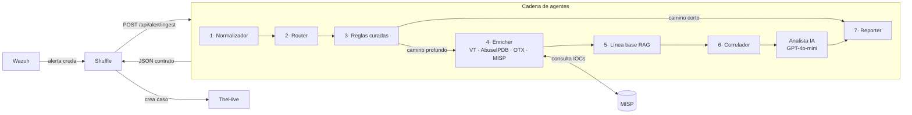

<div align="center">


# Vectus SOC Engine

**Motor de inteligencia para SOC — triage autónomo de alertas con análisis de comportamiento por IA**

De una alerta cruda de Wazuh a un caso enriquecido, correlacionado y con veredicto razonado — listo para TheHive. Sin orquestar nada: recibe, analiza, devuelve.


</div>

---

## ¿Qué es?

**Vectus SOC Engine** es un motor multi-agente que recibe alertas crudas de Wazuh (vía Shuffle), las procesa por una cadena de agentes especializados, y devuelve un JSON estandarizado con veredicto, severidad, contexto enriquecido y una descripción de caso redactada para el analista.

El motor **no orquesta, no crea casos, no habla con TheHive**: es una pieza pura de análisis. Recibe la alerta, la enriquece con inteligencia de múltiples fuentes, la correlaciona con el histórico, razona sobre su comportamiento y devuelve el resultado. Shuffle se encarga de llevar ese resultado a TheHive.

Su principio rector: **nunca afirmar lo que la evidencia no sostiene**. Un `true_positive` exige evidencia real —reputación maliciosa verificada, patrón de ataque, o comportamiento observado—; nunca el solo nivel de la regla de Wazuh. Cuando no hay certeza, deriva a revisión humana en vez de inventar un veredicto.

---

## Características

- **Triage por comportamiento, no por nivel de regla.** El motor analiza la línea de comando, el árbol de procesos, el path de ejecución y la integridad — no el `rule.level` de Wazuh. Detecta credential dumping, ejecución remota, escalamiento de privilegios o destrucción de datos aunque la regla de origen sea de bajo nivel, y **sin reglas prearmadas**: el analista IA generaliza sobre el comportamiento.
- **Enriquecimiento multi-fuente** con VirusTotal, AbuseIPDB, OTX y MISP (inteligencia propia + feeds), con caché y rate limiting para respetar las cuotas de los tiers gratuitos.
- **Línea base RAG.** Cada alerta se compara contra el histórico de comportamiento del activo (embeddings + ChromaDB) para medir rareza.
- **Correlación temporal y por observables.** Vincula alertas en una ventana de tiempo por host compartido u observables no genéricos.
- **Analista IA final.** GPT-4o-mini recibe el dossier completo y emite el veredicto razonado con la descripción del caso.
- **Anti-ruido supervisado.** El motor cuenta y sugiere supresiones por tasa; el humano aprueba. Todo auditado y reversible.
- **Idempotencia robusta.** Reproceso versionado, alertas huérfanas reencoladas al arrancar.
- **Degradación elegante.** Si una fuente se cae, su bloque queda en `error` y el análisis sigue. Si el analista IA falla, deriva a `needs_review` con el dossier adjunto. El motor nunca inventa lo que no verificó.

---

## Arquitectura



**Camino corto** — cuando una regla curada resuelve con certeza (ruido benigno identificado: logons de servicio, AppArmor `__pycache__`, FIM de snapd), se resuelve en milisegundos sin gastar tokens. Si la alerta trae observables públicos (un hash de FIM), la reputación se consulta igual — un hash malicioso da vuelta cualquier veredicto benigno.

**Camino profundo** — cuando hay decisión preliminar, observables con señales o evidencia de reputación: pasa por enriquecimiento, línea base, correlación y el analista IA, que emite el veredicto final con el dossier completo.

---

## Los agentes

| # | Agente | Responsabilidad |
|---|--------|-----------------|
| 1 | **Normalizador** | Convierte el JSON crudo de Wazuh (cualquier formato) en la estructura interna estándar. Extrae observables, comportamiento de endpoint (command line, árbol de procesos, integridad), MITRE y deriva el `alert_id` idempotente. |
| 2 | **Router** | Clasifica la alerta y decide qué observables ameritan reputación externa. |
| 3 | **Reglas curadas** | Patrones deterministas de certeza absoluta (ruido benigno conocido, configuraciones inseguras verificables). Resuelve el camino corto. |
| 4 | **Enricher** | Reputación externa (VT/AbuseIPDB/OTX) + inteligencia MISP propia y de feeds, con caché y rate limit. |
| 5 | **Línea base (RAG)** | Mide la rareza de la alerta contra el histórico de comportamiento del activo (embeddings + ChromaDB). |
| 6 | **Correlador** | Vincula alertas en ventana temporal por host u observables compartidos no genéricos. |
| 7 | **Reporter** | Ensambla el contrato JSON final y la descripción del caso, con el bloque de inteligencia MISP destacado. |
| ★ | **Analista IA** | GPT-4o-mini (temp 0.1). Recibe el dossier completo y emite el veredicto final razonado. Juzga por comportamiento, no por nivel de regla. |

**Procedencia del veredicto** (`internal_analysis.verdict_source`): `curated_rule` · `evidence_rule` (reputación maliciosa verificada) · `analyst` · `fallback` (analista caído → `needs_review`, nunca inventado).

**Regla de oro:** `true_positive` solo sale de (a) reglas curadas de certeza absoluta, (b) evidencia de reputación verificada, o (c) el analista con el dossier. El nivel de la regla Wazuh por sí solo jamás lo produce.

---

## Integraciones

| Sistema | Rol |
|---------|-----|
| **Wazuh** | Fuente de alertas (SIEM/XDR). |
| **Shuffle** | Orquestación: lleva la alerta al motor y el resultado a TheHive. |
| **TheHive** | Gestión de casos. Recibe el caso enriquecido. Push manual de IOCs hacia MISP. |
| **MISP** | Inteligencia de amenazas. El enricher consulta sus IOCs (propios + feeds). Análisis bidireccional. |
| **Cortex** | Conectado (análisis complementario, en reserva). |

---

## Stack

`Python 3.10` · `FastAPI` · `Uvicorn` · `SQLite` · `ChromaDB` (RAG) · `OpenAI GPT-4o-mini` · `Docker` + `Docker Compose`

---

## Estructura

```
vectus-soc/
├── app/
│   ├── main.py            # API FastAPI: endpoints, ingest, idempotencia
│   ├── pipeline.py        # Orquestación de la cadena de agentes
│   ├── contract.py        # Contrato de salida estandarizado (Pydantic)
│   ├── config.py          # Configuración vía entorno
│   ├── db.py              # Persistencia SQLite: resultados, correlación, supresiones
│   └── agents/
│       ├── normalizer.py  # 1· Normalización + observables + comportamiento
│       ├── router.py      # 2· Clasificación y ruteo
│       ├── rules.py       # 3· Reglas curadas + post-enriquecimiento
│       ├── enricher.py    # 4· Reputación externa + MISP
│       ├── baseline.py    # 5· Línea base RAG
│       ├── correlator.py  # 6· Correlación temporal/observables
│       ├── reporter.py    # 7· Ensamblado del contrato + descripción
│       └── analyst.py     # ★ Analista IA final
└── tests/                 # test_fase1 · test_fase2 · test_fase3
```

---

## Puesta en marcha

```bash
git clone https://github.com/Rodrigo-Vectus/vectus-soc-ai.git
cd vectus-soc-ai
cp .env.example .env          # cargar las API keys (ver Configuración)
docker compose up --build -d
curl http://localhost:8003/health
```

El motor queda en **`http://localhost:8003`**. SQLite y ChromaDB persisten en el volumen `vectus-data`.

---

## Configuración (`.env`)

| Variable | Uso |
|----------|-----|
| `API_KEY` | Protege los endpoints con header `X-API-Key` (vacío = abierto). |
| `OPENAI_API_KEY` | Analista final + embeddings de línea base. Sin ella el motor degrada a reglas curadas + reputación. |
| `VIRUSTOTAL_API_KEY` · `ABUSEIPDB_API_KEY` · `OTX_API_KEY` | Reputación externa. Cada una independiente: la que falte queda `not_configured`. |
| `MISP_URL` · `MISP_API_KEY` · `MISP_VERIFY_SSL` | Inteligencia MISP (propia + feeds). |
| `VT_MIN_INTERVAL` (15) | Segundos entre llamadas reales a VT (tier free 4/min). |
| `ENRICH_CACHE_TTL_HOURS` (24) | Caché de reputación: el mismo observable no gasta cuota dos veces. |
| `RAG_SIM_THRESHOLD` (0.20) · `RAG_WINDOW_DAYS` (90) · `COLDSTART_MIN_BASELINE` (50) | Línea base. |
| `CORRELATION_WINDOW_HOURS` (24) · `CORRELATION_MAX_RELATED` (10) | Correlación. |
| `REVIEW_MIN_LEVEL` (7) · `INGEST_MAX_WAIT` (25) | Umbrales de ruteo e ingesta. |
| `NOISE_MIN_COUNT` (20) · `NOISE_WINDOW_HOURS` (168) | Anti-ruido supervisado. |
| `PROCESSING_TIMEOUT_MINUTES` (10) · `MAX_PAYLOAD_KB` (512) · `ENRICH_RETRIES` (2) | Endurecimiento operativo. |

---

## Endpoints

| Método | Ruta | Descripción |
|--------|------|-------------|
| `GET` | `/` · `/health` | Info / healthcheck. |
| `POST` | `/api/alert/ingest` | Alerta cruda de Wazuh → 200 con contrato completo, o 202 + GET diferido. |
| `GET` | `/api/alert/{id}` | Recupera resultado de alertas que excedieron `INGEST_MAX_WAIT`. |
| `POST` | `/api/rag/bulk-load` | Carga histórico a la línea base (máx. 500 por request). |
| `GET` | `/api/noise/candidates` | Firmas candidatas a supresión por tasa, con evidencia. |
| `POST` | `/api/noise/suppress` | Aprueba una supresión (autoría obligatoria). |
| `DELETE` | `/api/noise/suppress/{id}` | Revoca una supresión (auditada). |
| `GET` | `/api/noise/suppressions` | Auditoría de supresiones. |
| `POST` | `/api/alert/{id}/reprocess` | Reanaliza con reglas/keys/línea base actuales; archiva versionado. |
| `GET` | `/api/stats` | Métricas: veredictos, fuente, caché, firmas, supresiones. |

> Con el rate limit de VT, una alerta con varios observables nuevos puede exceder los 25 s del POST: responde `202 {alert_id, status: processing}` y Shuffle recupera con el GET.

---

## Filosofía de diseño

- **Evidencia o nada.** El motor solo afirma lo que puede sostener. Cada `case_description` declara qué fuentes operaron y cuáles no.
- **Comportamiento > nivel de regla.** El `rule.level` indica cuán ruidosa es una regla, no cuán peligrosa es la actividad. El motor juzga por lo que el proceso hace.
- **La duda es honesta.** Ante evidencia insuficiente o contradictoria, `needs_review` y ojos humanos — nunca una certeza fingida.
- **El humano decide lo irreversible.** Las supresiones de ruido las sugiere el motor pero las aprueba una persona, con autoría y auditoría.
- **Degradar, no romper.** Cualquier fuente puede caerse sin tumbar el análisis.

---

<div align="center">

**Grupo Vectus** · SOC Engineering

</div>
