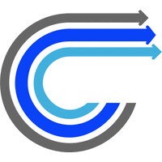
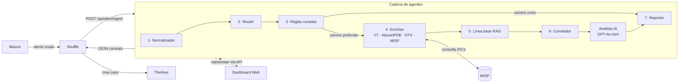

<div align="center">



# Vectus SOC

**Plataforma de triage autónomo de alertas de seguridad con análisis de comportamiento por IA**

De una alerta cruda de Wazuh a un caso enriquecido, correlacionado y con veredicto razonado — más un panel operativo para visualizar, investigar y actuar.


</div>

---

## ¿Qué es?

**Vectus SOC** es una plataforma de operaciones de seguridad compuesta por dos piezas que trabajan juntas:

1. **El Motor** (`Vectus SOC Engine`) — un servicio multi-agente que recibe alertas crudas de Wazuh (vía Shuffle), las procesa por una cadena de agentes especializados, las enriquece con inteligencia de múltiples fuentes, las correlaciona con el histórico y emite un veredicto razonado. Devuelve un JSON estandarizado listo para crear casos en TheHive.

2. **El Dashboard** — un panel web que lee la base del motor en solo-lectura y permite visualizar métricas, investigar alertas en detalle, ver la inteligencia que el motor acumula, gestionar usuarios y disparar acciones (reprocesar una alerta, dejar notas).

El principio rector de toda la plataforma: **nunca afirmar lo que la evidencia no sostiene**. Un `true_positive` exige evidencia real —reputación maliciosa verificada, patrón de ataque, o comportamiento observado—; nunca el solo nivel de la regla de Wazuh. Cuando no hay certeza, deriva a revisión humana en vez de inventar un veredicto.

---

## Arquitectura general



El motor y el dashboard se levantan juntos con un solo `docker compose up`. El dashboard lee la base del motor en **solo-lectura** (nunca la modifica) y, para acciones como reprocesar, llama a la API del motor por la red interna.

---

## Componente 1 — El Motor SOC

### Características

- **Triage por comportamiento, no por nivel de regla.** Analiza la línea de comando, el árbol de procesos, el path de ejecución y la integridad — no el `rule.level` de Wazuh. Detecta credential dumping, ejecución remota, escalamiento o destrucción de datos aunque la regla de origen sea de bajo nivel, y **sin reglas prearmadas**: el analista IA generaliza sobre el comportamiento observado.
- **Enriquecimiento multi-fuente** con VirusTotal, AbuseIPDB, OTX y MISP (inteligencia propia + feeds), con caché y rate limiting para respetar las cuotas de los tiers gratuitos.
- **Línea base RAG.** Cada alerta se compara contra el histórico de comportamiento del activo (embeddings + ChromaDB) para medir su rareza.
- **Correlación temporal y por observables.** Vincula alertas en una ventana de tiempo por host compartido u observables no genéricos.
- **Analista IA final.** GPT-4o-mini (temp 0.1) recibe el dossier completo y emite el veredicto razonado con la descripción del caso.
- **Anti-ruido supervisado.** El motor cuenta y sugiere supresiones por tasa; el humano aprueba. Todo auditado y reversible.
- **Idempotencia robusta.** Reproceso versionado, alertas huérfanas reencoladas al arrancar.
- **Retención automática.** Una tarea en background purga datos antiguos cada 24h (raw_json, eventos de firma, caché, correlaciones viejas) y hace VACUUM, manteniendo la base acotada sin intervención.
- **Degradación elegante.** Si una fuente se cae, su bloque queda en `error` y el análisis sigue. Si el analista IA falla, deriva a `needs_review` con el dossier adjunto. El motor nunca inventa lo que no verificó.

### Los agentes

| # | Agente | Responsabilidad |
|---|--------|-----------------|
| 1 | **Normalizador** | Convierte el JSON crudo de Wazuh en la estructura interna estándar. Extrae observables, comportamiento de endpoint (command line, árbol de procesos, integridad), MITRE y deriva el `alert_id` idempotente. |
| 2 | **Router** | Clasifica la alerta y decide qué observables ameritan reputación externa. |
| 3 | **Reglas curadas** | Patrones deterministas de certeza absoluta (ruido benigno conocido, configuraciones inseguras verificables). Resuelve el camino corto. |
| 4 | **Enricher** | Reputación externa (VT/AbuseIPDB/OTX) + inteligencia MISP propia y de feeds, con caché y rate limit. |
| 5 | **Línea base (RAG)** | Mide la rareza de la alerta contra el histórico de comportamiento del activo (embeddings + ChromaDB). |
| 6 | **Correlador** | Vincula alertas en ventana temporal por host u observables compartidos no genéricos. |
| 7 | **Reporter** | Ensambla el contrato JSON final y la descripción del caso, con el bloque de inteligencia MISP destacado. |
| ★ | **Analista IA** | GPT-4o-mini (temp 0.1). Recibe el dossier completo y emite el veredicto final razonado. Juzga por comportamiento, no por nivel de regla. |

**Procedencia del veredicto** (`internal_analysis.verdict_source`): `curated_rule` · `evidence_rule` (reputación maliciosa verificada) · `analyst` · `fallback` (analista caído → `needs_review`, nunca inventado).

**Regla de oro:** `true_positive` solo sale de (a) reglas curadas de certeza absoluta, (b) evidencia de reputación verificada, o (c) el analista con el dossier. El nivel de la regla Wazuh por sí solo jamás lo produce.

### Endpoints del motor

| Método | Ruta | Descripción |
|--------|------|-------------|
| `GET` | `/` · `/health` | Info / healthcheck. |
| `POST` | `/api/alert/ingest` | Alerta cruda de Wazuh → 200 con contrato completo, o 202 + GET diferido. |
| `GET` | `/api/alert/{id}` | Recupera el resultado de una alerta. |
| `POST` | `/api/rag/bulk-load` | Carga histórico a la línea base. |
| `GET` | `/api/noise/candidates` | Firmas candidatas a supresión por tasa. |
| `POST` | `/api/noise/suppress` | Aprueba una supresión (autoría obligatoria). |
| `DELETE` | `/api/noise/suppress/{id}` | Revoca una supresión (auditada). |
| `POST` | `/api/alert/{id}/reprocess` | Reanaliza con reglas/keys/línea base actuales; archiva versionado. |
| `GET` | `/api/stats` | Métricas operativas. |

---

## Componente 2 — El Dashboard Web

Panel de operaciones que lee la base del motor en solo-lectura, con autenticación, roles y acciones auditadas.

### Características

- **Acceso por OTP + JWT.** Login con código de un solo uso al email, sesión por cookie httponly, rate limit por IP y salvaguardas anti-lockout (nunca quedan 0 admins).
- **Roles** `admin` / `viewer`. Las acciones sensibles (gestión de usuarios, reprocesar) son solo de admin.
- **Panel de operaciones.** Métricas en vivo (total, true/false positive, informational, needs review, observables), gráficos de tendencia, distribución de veredictos, fuente del veredicto y familia de alerta.
- **Filtro temporal flexible.** Rangos rápidos (15m, 1h, 24h, 7d, 30d…) y rango personalizado por fecha y hora.
- **Drill-down.** Click en un segmento de un gráfico filtra la tabla por esa categoría.
- **IOCs más frecuentes** en alertas confirmadas como amenaza.
- **Detalle de alerta.** Panel lateral con el dossier completo: análisis del caso, MITRE ATT&CK, factores clave, observables con su veredicto, correlación, próximos pasos y el JSON crudo recibido.
- **Acciones sobre la alerta.** Reprocesar con datos actuales (admin) y notas del analista.
- **Inteligencia del motor.** Las firmas de comportamiento recurrentes que forman la línea base y las supresiones de ruido vigentes.
- **Gestión de usuarios** y **auditoría** de accesos y acciones.
- **Tema claro/oscuro** con preferencia persistente.

### Seguridad y aislamiento

- El dashboard monta la base del motor en **modo solo-lectura** (`:ro`): nunca puede modificarla.
- Su única escritura es a su **propia base** (usuarios, OTP, auditoría, notas), separada de la del motor.
- Las acciones que modifican datos del motor (reprocesar) se hacen llamando a la **API del motor**, no tocando su base.
- Todas las acciones quedan registradas en el log de auditoría.

---

## Stack

`Python 3.10` · `FastAPI` · `Uvicorn` · `SQLite` · `ChromaDB` (RAG) · `OpenAI GPT-4o-mini` · `HTML/CSS/JS` (sin frameworks de frontend) · `Chart.js` · `Docker` + `Docker Compose`

---

## Estructura

```
vectus-soc/
├── docker-compose.yml         # levanta motor + dashboard juntos
├── Dockerfile                 # imagen del motor
├── app/                       # EL MOTOR
│   ├── main.py                #   API, ingest, idempotencia, scheduler de retención
│   ├── pipeline.py            #   orquestación de la cadena de agentes
│   ├── contract.py            #   contrato de salida estandarizado
│   ├── config.py              #   configuración vía entorno
│   ├── db.py                  #   persistencia SQLite + retención
│   └── agents/                #   los 7 agentes + analista IA
├── dashboard/                 # EL DASHBOARD
│   ├── api.py                 #   backend FastAPI (auth + API de lectura + acciones)
│   ├── Dockerfile
│   ├── requirements_docker.txt
│   └── static/                #   login, dashboard, usuarios, inteligencia, auditoría
├── docs/                      # logo y assets
└── tests/                     # test_fase1 · test_fase2 · test_fase3
```

---

## Puesta en marcha

```bash
git clone https://github.com/Rodrigo-Vectus/vectus-soc-ai.git
cd vectus-soc-ai

# Configurar el motor
cp .env.example .env                  # cargar API keys del motor (OpenAI, VT, MISP…)

# Configurar el dashboard
cd dashboard && ./setup.sh && cd ..   # genera dashboard/.env (admin, SMTP, JWT)

# Levantar todo
docker compose up -d --build
```

- **Motor**: `http://localhost:8003` (health en `/health`)
- **Dashboard**: `http://localhost:8005`

El primer acceso al dashboard se siembra con el email de `ADMIN_EMAIL`. Si no se configuró SMTP, el código OTP de acceso aparece en los logs: `docker logs vectus-soc-dashboard | grep OTP`.

---

## Configuración

### Motor (`.env`)

| Variable | Uso |
|----------|-----|
| `API_KEY` | Protege los endpoints con header `X-API-Key` (vacío = abierto). |
| `OPENAI_API_KEY` | Analista IA + embeddings de línea base. |
| `VIRUSTOTAL_API_KEY` · `ABUSEIPDB_API_KEY` · `OTX_API_KEY` | Reputación externa (cada una independiente). |
| `MISP_URL` · `MISP_API_KEY` | Inteligencia MISP (propia + feeds). |
| `RETAIN_RAW_DAYS` · `RETAIN_*` | Política de retención automática. |
| `CLEANUP_INTERVAL_HOURS` | Frecuencia de la limpieza en background. |

### Dashboard (`dashboard/.env`)

| Variable | Uso |
|----------|-----|
| `ADMIN_EMAIL` | Primer admin sembrado al arrancar. |
| `JWT_SECRET` | Firma de las sesiones (auto-generado por `setup.sh`). |
| `ENGINE_URL` | URL del motor para acciones (`http://engine:8003` en el stack unificado). |
| `SMTP_HOST` · `SMTP_EMAIL` · `SMTP_PASSWORD` | Envío del código OTP (opcional; si falta, se loguea). |
| `COOKIE_SECURE` | `true` cuando el panel quede detrás de HTTPS. |

---

## Filosofía de diseño

- **Evidencia o nada.** La plataforma solo afirma lo que puede sostener. Cada caso declara qué fuentes operaron y cuáles no.
- **Comportamiento > nivel de regla.** El `rule.level` indica cuán ruidosa es una regla, no cuán peligrosa es la actividad. El motor juzga por lo que el proceso hace.
- **La duda es honesta.** Ante evidencia insuficiente o contradictoria, `needs_review` y ojos humanos — nunca una certeza fingida.
- **El humano decide lo irreversible.** Las supresiones de ruido las sugiere el motor pero las aprueba una persona, con autoría y auditoría.
- **Degradar, no romper.** Cualquier fuente puede caerse sin tumbar el análisis.
- **Solo-lectura por defecto.** El dashboard observa; actúa solo a través de la API del motor, nunca tocando su base.

---

<div align="center">

**Grupo Vectus** · SOC Engineering

</div>
